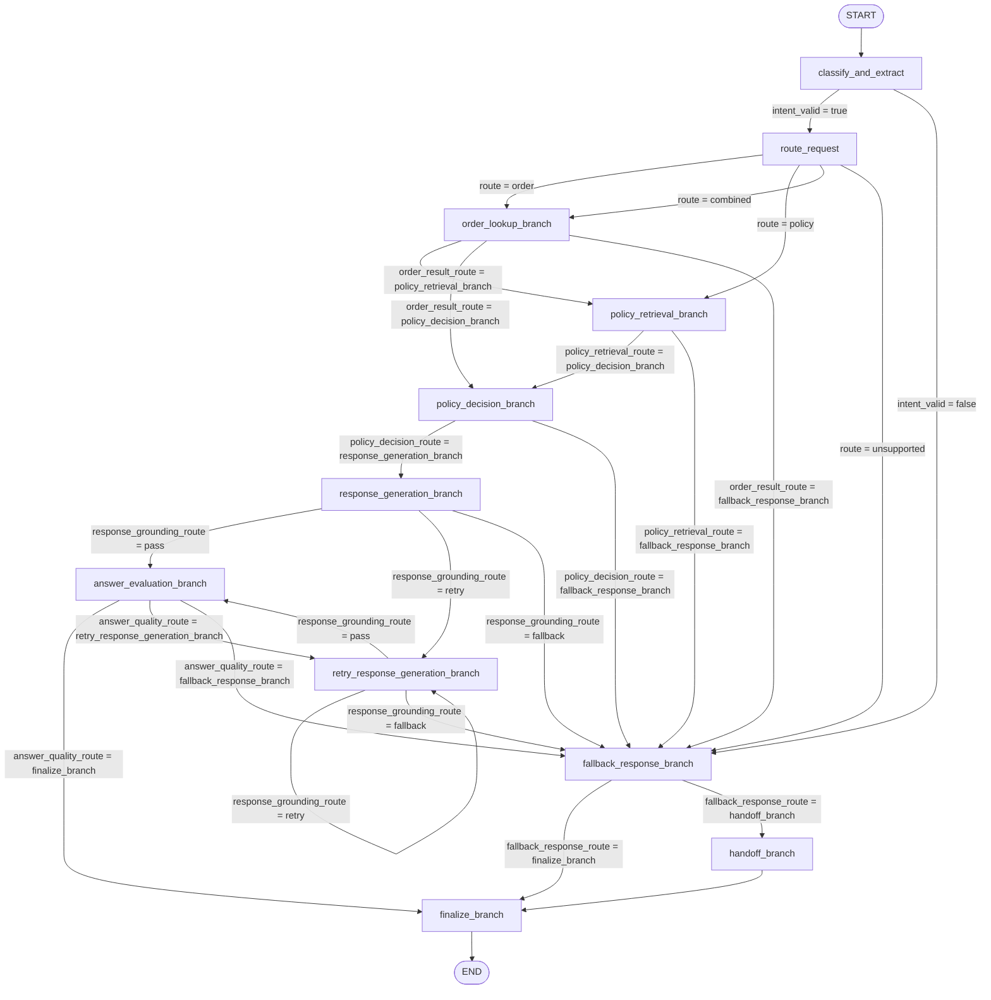

# Customer Support Agent

This folder contains the base customer support agent.

The base agent owns only business behavior:

- classify and extract customer intent
- route the request
- look up order and policy data
- make a policy decision
- generate and validate a response
- retry, fallback, hand off, or finalize when needed

The base agent must depend only on business components. Runtime instrumentation
adapters are implemented outside this package and reuse this same business flow.

## Task Flow

```text
customer_support_agent

  classify_and_extract
    -> route_request if intent_valid = true
    -> fallback_response_branch if intent_valid = false

  route_request
    -> order_lookup_branch if route = order
    -> policy_retrieval_branch if route = policy
    -> order_lookup_branch if route = combined
    -> fallback_response_branch if route = unsupported

  order_lookup_branch
    -> policy_retrieval_branch if route = combined and order is valid
    -> policy_decision_branch if route = order and order is valid
    -> fallback_response_branch if order is invalid

  policy_retrieval_branch
    -> policy_decision_branch if policy retrieval is valid
    -> fallback_response_branch if policy retrieval is invalid

  policy_decision_branch
    -> response_generation_branch if policy decision can be answered
    -> fallback_response_branch if more information or handoff is needed

  response_generation_branch
    -> answer_evaluation_branch if response is grounded
    -> retry_response_generation_branch if response should be retried
    -> fallback_response_branch if response should be blocked

  retry_response_generation_branch
    -> answer_evaluation_branch if retry response is grounded
    -> retry_response_generation_branch if another retry is allowed
    -> fallback_response_branch if retry limit or validation fails

  answer_evaluation_branch
    -> finalize_branch if answer quality passes
    -> retry_response_generation_branch if answer should be retried
    -> fallback_response_branch if answer should be blocked

  fallback_response_branch
    -> finalize_branch if fallback response is valid
    -> handoff_branch if fallback response is invalid

  handoff_branch
    -> finalize_branch

  finalize_branch
    -> END
```

## LangGraph Flow

The compiled LangGraph flow can be inspected from the task flow plan:

```python
compiled_graph = support_agent_task_flow_plan.build()
graph = compiled_graph.get_graph()
mermaid = graph.draw_mermaid()
```

The current task graph is:


